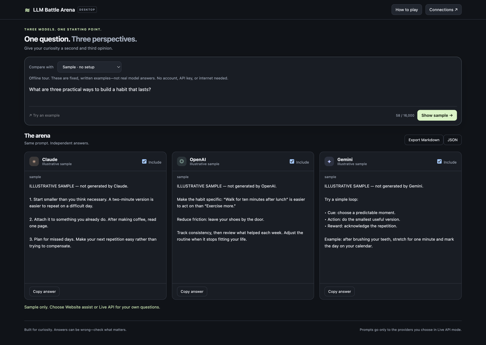

# LLM Battle Arena

**Current download: [v2.4.3](https://github.com/YobieBenjamin/llm-battle-arena/releases/tag/v2.4.3).** Older installer releases are archived and unavailable to the public; source tags remain for history.

## New here? Start here—no GitHub knowledge needed

**[CLICK HERE: beginner installation guide](START-HERE.md)** · **[CLICK HERE: download the app](https://github.com/YobieBenjamin/llm-battle-arena/releases/latest)**

GitHub is simply the website where this free app's files are kept. You do **not** need a GitHub account. You do **not** need to understand the folders above, click the green **Code** button, or download “Source code.” Choose your computer from the download table below; those are the ready-to-open installers.

**The short version:** download → open the installer → try Sample → add API keys in Connections → ask a question.

**One question. Three answers. Have fun seeing where Claude, OpenAI, and Gemini agree—or completely disagree.**

A small app for Mac and Windows. No terminal, Python, Node.js, server, or app account needed. Download it, open it, and try the free offline sample. Connect your own API keys when you want real answers.

## Download and play

| Your laptop | Download |
| --- | --- |
| **Windows — most Intel/AMD PCs** | **[Download Windows installer](https://github.com/YobieBenjamin/llm-battle-arena/releases/latest/download/LLM-Battle-Arena-Windows-x64-Setup.exe)** |
| **Mac — Apple Silicon (M1, M2, M3, M4, or newer)** | **[Download for Apple Silicon Mac](https://github.com/YobieBenjamin/llm-battle-arena/releases/latest/download/LLM-Battle-Arena-macOS-arm64.dmg)** |
| **Mac — Intel** | **[Download for Intel Mac](https://github.com/YobieBenjamin/llm-battle-arena/releases/latest/download/LLM-Battle-Arena-macOS-x64.dmg)** |
| Windows — ARM / Snapdragon | [Download Windows ARM installer](https://github.com/YobieBenjamin/llm-battle-arena/releases/latest/download/LLM-Battle-Arena-Windows-arm64-Setup.exe) |

[All downloads and version history](https://github.com/YobieBenjamin/llm-battle-arena/releases/latest) · [Step-by-step user guide](docs/USER_GUIDE.md) · [Report a problem](https://github.com/YobieBenjamin/llm-battle-arena/issues)

Windows builds are unsigned. Mac builds are ad-hoc signed (sealed, but without a verified publisher or Apple notarization). Your computer may ask you to approve the first launch. See [first-launch help](docs/USER_GUIDE.md#first-launch-security-prompts). Work/school laptop policies may block unsigned apps. This is for modern desktop Mac and Windows systems; it is not an iPhone, iPad, Chromebook, or browser extension app.

## 1. Install

**Windows:** download the installer above and double-click it. It installs for your user and opens the app. A shortcut appears on your desktop and in Start. No install wizard or administrator account is normally needed.

**Mac:** download the matching `.dmg`, double-click it, and drag **LLM Battle Arena** into **Applications**. Open it from Applications. To check your Mac type, choose Apple menu → About This Mac: “Chip” means Apple Silicon; “Processor: Intel” means Intel.

## 2. Try it immediately

1. Leave **Sample · no setup** selected.
2. Click **Show sample**.
3. Read the three example cards. No keys, signup, internet, or API charges are involved.
4. Try the tiny **Y** badge on the Gemini sample: hover to preview its example file, click to keep it open, and click again to hide it.

Samples are fixed, human-written examples, not actual model answers. For your own questions, use the next step.

## 3. Connect your models

1. Click **Connections** in the top right.
2. Paste your **Claude API key**, **OpenAI API key**, and **Gemini API key** into their matching fields. The **Get API key** buttons open each provider's official site.
3. Click **Check key & load models** and choose from the model menu.
4. Click **Save connections**. The app switches to **Live API · automatic** after the first key is saved.

You can start with one provider and uncheck **Include** on the others. For three real answers, connect all three.

**API access is separate from ChatGPT/Claude/Gemini chat subscriptions.** Providers may require billing and may charge for live requests. Gemini has free API access for certain models and quotas; check your account. The app itself is free. Never paste keys into GitHub issues or share them in screenshots.

## 4. Ask a question

1. Type a prompt, such as: **“Write a dramatic breakup letter from a toaster to a microwave.”**
2. Click **Compare**. The same prompt goes to every included provider at once.
3. Watch each answer arrive in its own card.
4. Decide which one wins. There is no automatic judge—this is a curiosity toy.

Try **“Explain Wi-Fi to a pirate,” “Invent the world's worst superhero,”** or **“What is a belief you think people should question?”**

- Tiny counters at the top of every card show **Q** (question), **A** (estimated visible answer), and **R** (reported reasoning, or — when unknown). **A always uses the same rough estimator across providers**; Q uses reported input when available. Hover over a counter for details. These are not prices.
- **Stop** preserves partial answers. **Retry** sends just that card's original prompt again and may incur another API charge.
- **Copy answer** copies one response. **Export Markdown** saves a readable comparison; **JSON** saves structured data.
- **Ctrl+Enter** (Windows) or **Cmd+Enter** (Mac) starts a comparison.
- Each question starts fresh. The last 50 comparisons are saved locally in History. Previous answers are never sent with a new question. Export anything you want to keep beyond those 50.

## A little Y means there is an artifact

When an answer contains a complete, labeled code/file block, a small **Y** badge appears on its card.

- **Hover:** peek at the artifact. Move away from the badge and preview to dismiss the peek.
- **Click:** keep it displayed while you read the other answers.
- **Click the same Y again:** hide it. The Close button also hides it.
- If there is more than one file, use its tabs. **Show source** displays the underlying HTML/SVG/JSON. **Save file** opens a save dialog.

HTML/SVG show an isolated static preview with scripts and networking disabled. JSON is formatted; CSV, Markdown, and source code display as text. JavaScript, Python, React, and other source files are not executed. The app detects code blocks in the answer—it does not fetch providers' private cloud artifacts or links.

Try: **“Make a small self-contained HTML greeting card. Put the full HTML in one fenced html code block.”**

## No keys? You can still play

Choose **Website assist · no API keys**, type a question, and click **Prepare comparison**. On each card, click **Open**: the app copies your prompt and opens that provider's official website. Paste and send it there, then paste its answer back into the card. Repeat for the others.

This mode is manual. Each website controls signup, models, and free limits; no universal “three free questions” is promised. The app never asks for website passwords.

## Questions, fixes, and more detail

- [Full user guide: installation, keys, updates, privacy, uninstalling, troubleshooting](docs/USER_GUIDE.md)
- [Developer guide: source, architecture, tests, packaging, releases](docs/DEVELOPMENT.md)
- [Release notes](docs/RELEASE_NOTES.md)
- [One-time code and documentation audit](docs/AUDIT.md)

Your keys are encrypted on your computer. Live prompts go directly to selected providers, or through OpenRouter when enabled; the app has no hosted server or analytics. Answers display formatted Markdown, with scripts, images and embedded content removed. Prompt and answer history is saved as plain text on this computer; use History to delete it. Models can be wrong; don't treat three similar answers as proof.

A fun little project by Yobie Benjamin. MIT licensed. The public home for code, downloads, and support is **YobieBenjamin/llm-battle-arena**.

[Claude review response and 2.2.1 fixes](docs/CLAUDE-REVIEW.md)

### More fun in 2.4

Blind battles shuffle and hide provider identities until you vote, with a local win tally. Connections offers model dropdowns, key checks without generation, and an optional OpenRouter route using one encrypted key. OpenRouter receives and routes your prompts and answers. Optional update notices make one GitHub request per launch and are off initially.

Busy-server HTTP 503/529 responses get one cancellable retry before streaming starts. CI tests the packaged Mac app, then independently downloads each published release to check all installer checksums, both Mac signatures and bundled source against the tag. Dependabot checks npm and Actions weekly. A weekly live API probe skips providers until dedicated secrets are configured; see [Maintainer setup](docs/MAINTENANCE.md).

Independent reviewers: use the [adversarial audit brief](docs/INDEPENDENT-AUDIT.md) for the pinned 2.4.0 source, release binaries, privacy boundaries, and novice workflows.
