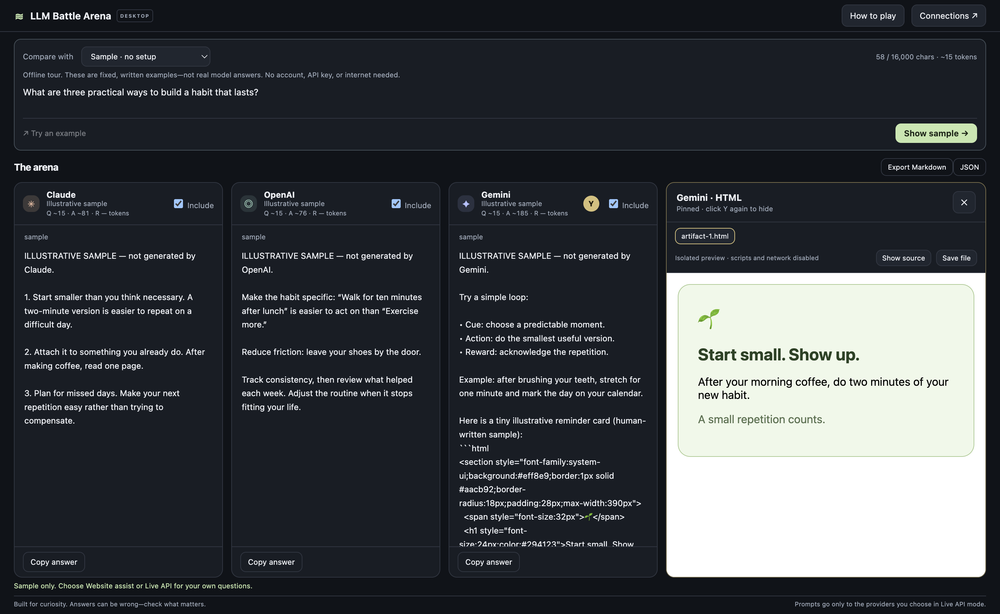

# LLM Battle Arena: the friendly user guide

One prompt, three answers, and no complicated setup. Start with the sample, then connect your own model accounts through API keys if you want live answers.

[Download the app](https://github.com/YobieBenjamin/llm-battle-arena/releases/latest) · [Back to the quick start](../README.md)

## Never used GitHub before?

That is fine. GitHub is just the download website for this app. You do not need to sign up, install Git, use a terminal, or understand source code.

1. Open the [beginner start page](../START-HERE.md) in your web browser.
2. Click the download link for your computer. A download means the installer file is being saved to your computer, usually in **Downloads**.
3. Open that file from your browser's downloads list or the Downloads folder.
4. Use the Mac or Windows instructions below.

If you end up on a GitHub release page, scroll down to **Assets**. Click the Setup `.exe` for Windows or `.dmg` for Mac. Ignore **Source code (zip)** and **Source code (tar.gz)**—those are for programmers. If Assets is collapsed, click its heading to expand it. The **Code**, **Fork**, and **Pull requests** buttons are not part of installation.

## Choose your download

| Computer | File to download |
| --- | --- |
| Most Windows laptops (Intel or AMD) | `LLM-Battle-Arena-Windows-x64-Setup.exe` |
| Windows laptop with an ARM/Snapdragon processor | `LLM-Battle-Arena-Windows-arm64-Setup.exe` |
| Mac with an Apple M-series chip | `LLM-Battle-Arena-macOS-arm64.dmg` |
| Mac with an Intel processor | `LLM-Battle-Arena-macOS-x64.dmg` |

**Not sure?** On Mac, Apple menu → About This Mac shows Chip or Processor. On Windows, Settings → System → About → System type shows whether the processor is x64 or ARM. Use a currently supported, updated version of macOS or Windows; older systems may not run the bundled Electron runtime. Windows 7/8 and 32-bit PCs are not supported.

Download the installer listed above, not GitHub's “Source code” ZIP. No GitHub account is needed to download public release assets. API keys require provider accounts, but the Arena itself has no account or password.

## Install on Windows

1. Click the Windows download link in the [README](../README.md), or find your Setup file on the [latest release](https://github.com/YobieBenjamin/llm-battle-arena/releases/latest).
2. Open your Downloads folder and double-click the downloaded `.exe`.
3. Follow any Windows security approval described below. Only proceed if you trust this project and obtained the file from this repository's release page.
4. The one-click installer installs for your Windows user, creates shortcuts, and opens the app. No destination-selection wizard is needed.
5. Next time, use the **LLM Battle Arena** shortcut on your desktop or in Start.

**Optional portable version:** release assets also include a `Portable.exe` for each Windows processor type. Double-click it to run without installing shortcuts. Connection settings are still saved in your Windows user profile, not alongside the portable file. Choose Setup for the easiest everyday experience.

## Install on Mac

1. Download the disk image matching your Mac's processor.
2. Double-click the `.dmg` in Downloads.
3. Drag **LLM Battle Arena** onto the **Applications** folder shown in the disk-image window.
4. Open Finder → Applications → **LLM Battle Arena**.
5. If macOS blocks the first launch, see the next section.
6. Once the installed copy opens, eject the disk image from Finder. You can delete the downloaded `.dmg` if you wish.
7. Next time, launch from Applications or Spotlight. You can also keep the app in your Dock.

Do not keep running the app from inside the disk image. Install it into Applications first.

## First-launch security prompts

Mac releases from 2.2.1 onward have an ad-hoc bundle signature verified during the build. They still have no verified publisher certificate or Apple notarization. Windows builds remain unsigned. A warning is expected; a warning alone is not proof that a download is safe. Use only this project's release page and decide whether you trust the source. Never turn off antivirus, Gatekeeper, or Smart App Control globally to run it.

**Mac:** bundle verification is not Gatekeeper approval. An ad-hoc build can still be blocked as untrusted. After an attempted launch, macOS may offer a per-app approval in System Settings → Privacy & Security → Open Anyway. Follow the prompts only if you trust the downloaded app. Exact wording varies by macOS version. If macOS reports “damaged,” do not assume Open Anyway will appear: download the latest release and report the exact message. We have not certified a fresh Safari-download approval flow on every Mac. [Apple's official explanation](https://support.apple.com/en-us/102445).

**Windows:** SmartScreen may say “Windows protected your PC.” Where Windows offers **More info → Run anyway**, that is a per-app choice you can make after checking the source. Smart App Control or an organization's policy may block it without offering that option. Do not disable those protections globally; on a managed machine, ask the administrator. [Microsoft's explanation of Smart App Control](https://support.microsoft.com/en-us/windows/security/threat-malware-protection/smart-app-control-frequently-asked-questions).

Publisher signing would reduce installation friction, but these downloads do not claim a verified publisher identity.

## Your first minute: try Sample

1. Open the app.
2. Leave **Sample · no setup** selected.
3. Click **Show sample**.
4. Read the three example answers. Scroll inside any card to read more.
5. Click **How to play** at the top whenever you want a reminder.

The sample question is fixed and cannot be edited in this mode. Sample answers are human-written illustrations, not model output. They work offline and make no API calls. Choose Live API or Website assist for your own questions.

## Connect your API keys

API keys are like access passes for software. They are not your chat website username or password. Paying for a chat subscription does not automatically enable the matching API.

1. Click **Connections**.
2. For each provider, click **Get API key** to open its official developer site in your browser.
3. Sign in there and create or find an API key. Providers may ask you to create a project or enable billing. Their screens and account requirements change over time.
4. Copy the key and paste it into the matching Arena field. You can use the normal keyboard paste shortcut.
5. Click **Check key & load models**, then choose a model from the menu. Availability depends on your provider account.
6. Repeat for the other providers, then click **Save connections**.
7. With at least one saved key, the app selects **Live API · automatic**.

Official key pages: [Anthropic](https://platform.claude.com/settings/keys), [OpenAI](https://platform.openai.com/api-keys), [Google AI Studio](https://aistudio.google.com/api-keys).

You can start with one key. Uncheck **Include** on cards you have not connected. For the direct route, three automatic answers require all three keys and working provider accounts. Alternatively, choose OpenRouter to use one key. Saving checks credentials through model-list requests, but does not validate generation access or billing credit.

**Cost:** the Arena is free. Providers control API charges, credits, and quotas. Gemini has free tiers for some API models, but a free allowance is not guaranteed for every model or account. A comparison can make three paid requests, and Retry makes another request to that provider. Start with short questions and the default output limit. Set spending controls in the provider dashboards if desired.

### Change or remove a key

- Open Connections, paste a new key into that provider's field, and Save connections to replace it.
- Leave a key field blank to keep the saved key. The app does not display saved keys.
- Check **Remove saved key** and Save connections to delete it locally. If both a replacement and Remove are selected, removal takes precedence.
- To invalidate a key everywhere, revoke it in the provider's own dashboard. Removing it from this app alone does not revoke it.

## Run a real comparison

1. Select **Live API · automatic**.
2. Check **Include** on the providers you want.
3. Type a question into the compact prompt box. Long prompts scroll inside that box; click it and use the mouse wheel, trackpad, or arrow keys to move through the text.
4. Click **Compare** or press Ctrl+Enter on Windows / Cmd+Enter on Mac.
5. Each provider starts independently. One error does not cancel the other answers.
6. Scroll inside each answer card to read its full response. You can select text and copy it, or use **Copy answer** for the whole answer.

The exact same prompt goes to every included provider. Each new comparison starts fresh: previous answers are not sent as conversation history. Model IDs appear on cards so you know which models were used. OpenAI API results are not necessarily identical to the ChatGPT website's answers.

### Controls explained

| Control | What it does |
| --- | --- |
| Include | Selects which providers receive your prompt on the next comparison. |
| Output limit | Sets the maximum generated token budget per provider. Some models use part of this budget for reasoning. It is not a fixed word count or price estimate. |
| Stop | Stops active requests; keeps whatever text has arrived. It does not undo provider charges already incurred. |
| Retry | Repeats only that card using the original comparison prompt and output limit. A fresh response may be different. |
| Copy answer | Copies the entire answer, including text below the visible scroll area. |
| Export Markdown | Opens a save dialog for a readable `.md` file containing the prompt and all recorded results. |
| JSON | Opens a save dialog for structured data including mode, prompt, results, and status. It contains no saved API keys. |
| Try an example | Fills in an example question in a mode that accepts your own prompts. |
| How to play | Opens a short guide inside the app. |

An answer may show **output limit reached**. Try a shorter question or a higher output limit and Retry. When no text is returned, reasoning may have consumed the budget or the provider may have blocked generation. Answers format Markdown headings, lists, tables, emphasis and code. Scripts, images and embedded content are removed. Click ordinary HTTP/HTTPS links to open them in your system browser. Copy answer and exports preserve the original Markdown. In Website assist, use **Read formatted** after pasting; **Edit pasted answer** returns to the paste box.

## What do the tiny token counters mean?

- **Q**: question/input tokens, reported by the provider when available, otherwise estimated.
- **A ~**: the visible answer text, always estimated using the same local rule for all three providers (about four Unicode characters per token). This is an approximate comparison of visible answer size, not an exact model-token count.
- **R**: separately reported reasoning/thinking tokens. **—** means the provider did not report a separate count; it does not mean zero.

A token is a piece of text, not necessarily a word. Estimates can be substantially wrong for languages other than English, code, or emoji. Counts are not prices. The draft question's estimate is shown above the prompt box. Existing result counters stay attached to their original question even when you type a new draft.

Provider output usage is shown in the hover explanation and both export formats. OpenAI output usage can include reasoning and non-visible formatting; Gemini reports answer candidates and thoughts separately. Even subtracting reasoning does not guarantee an exact visible-text count, so A consistently estimates only the displayed answer. JSON keeps the original usage fields plus the labeled summary. Markdown includes Q/A/R and raw provider output usage.

While an answer streams, A grows with the visible text. Sample and Website assist make no extra token API calls. Use your provider dashboard to check actual charges.

## Have some fun

- “Write a dramatic breakup letter from a toaster to a microwave.”
- “Explain black holes to a five-year-old, then to a pirate.”
- “Give me a terrible business idea and sell it like it is brilliant.”
- “Invent a superhero whose only power is mildly inconvenient.”
- “Give three different endings to a mystery about a missing sock.”
- “Find the flaw in this argument: all cats are mammals, so all mammals are cats.”

Judge the results yourself: funniest, clearest, most useful, or most surprising. There is no automatic quality score, and fastest does not necessarily mean best.

## Use it without API keys: Website assist

1. Select **Website assist · no API keys**.
2. Enter your prompt and choose the providers with Include.
3. Click **Prepare comparison**.
4. Click **Open Claude**, **Open OpenAI**, or **Open Gemini** on a card. The app copies your prompt and opens the official site in your system browser.
5. Paste the prompt into that website, sign in if required, and submit it yourself.
6. Copy the resulting answer from the website.
7. Return to the Arena and paste it into that provider's answer field. The field scrolls as the answer grows.
8. Repeat for the other providers, then copy or export the comparison.

This mode does not automate website submissions or read website answers. Each provider controls its own free limits and login requirements. There is no guaranteed shared “one or three free questions” offer. The app never collects website passwords.

Changing the prompt or included providers in Website assist clears the pasted comparison to avoid mixing answers from different questions. Export before changing those settings if you want to keep it.

## Preview artifacts with the Y badge

The Arena recognizes complete, labeled fenced code blocks as files. A small gold **Y** appears at the top of the matching answer card. Examples include HTML, SVG, JSON, CSV, Markdown, JavaScript, TypeScript/JSX/TSX, Python, CSS, and text. An unfinished code block does not produce a badge until its closing fence arrives. Up to 12 files are shown per answer, each limited to one million characters.

1. **Hover over Y** to reveal the preview. You can move your pointer into the preview to inspect it; moving away from both hides an unpinned peek.
2. **Click Y** to pin the preview in a dock beside the cards on wide windows or below the cards on smaller windows. It stays displayed without covering the answer controls. On smaller windows, scroll the results area to move between the answers and the preview; both keep readable heights. Ctrl/Cmd+Enter still starts a comparison while the preview is pinned (except inside website-answer paste boxes).
3. **Click the same Y again** to hide it. The Close button also hides it.
4. A pinned file stays put if you merely hover over another provider's badge. Clicking the other provider's Y deliberately switches the pinned preview.
5. Use the filename tabs for multiple files. **Show source** toggles the source view for HTML, SVG, and JSON.
6. **Save file** opens your computer's save dialog. Choose a folder and click Save. The app does not automatically open or execute the saved file.

HTML/SVG are rendered in an isolated static frame: no JavaScript, outside images, network access, forms, or app controls. Inline styling and data-embedded images can display. JSON is prettified when valid; CSV, Markdown, and programming languages are displayed as source text. The preview will not run a React project or execute Python. Saved HTML can run scripts and make network requests when you open it in a browser. The in-app preview restrictions do not follow the file into another program.

This feature detects files embedded in the answer text. It does not retrieve Claude/ChatGPT/Gemini website artifacts, cloud documents, remote images, or private links. If no Y appears, try asking: **“Give me a complete self-contained HTML file in a fenced html code block.”**

The Gemini sample includes a human-written HTML reminder card so you can try Y without keys or a charge. Model-generated files are not guaranteed to be correct.

## Keep or share a comparison

Click **Export Markdown** or **JSON**, choose a folder and filename, and save. The export includes answers even when they extend below the visible part of a card, plus errors or partial results if a run failed or was stopped.

The app automatically saves the last 50 comparisons, including Sample and Website assist. Click **History**, then click a question to reopen it. Reopening never calls a provider. An unfinished saved answer is labeled interrupted; Retry in Live API mode is an explicit new request and may cost money. Each new question still starts fresh.

Use **Delete** beside an entry to remove it. To clear everything, click **Delete all history**, then **Confirm delete all**. Export anything you want to keep beyond the latest 50. History is plain text in `history.json` in the app data folder, not encrypted like API keys. It may contain sensitive information you typed. Streaming/pasted answers save approximately every half second, and on normal close; a crash can lose the latest unsaved fragment. Damaged history is backed up as `history.json.<time>.bak`, with its location shown in History. Deleting history does not remove these recovery backups or files you exported. Files and clipboard contents can contain sensitive prompts or answers, so check them before sharing.

## Updates

There is no background updater. Download a newer installer from [Releases](https://github.com/YobieBenjamin/llm-battle-arena/releases/latest).

- **Windows:** close the Arena and run the newer Setup file for the same processor type.
- **Mac:** close the Arena, open the newer `.dmg`, and replace the existing app in Applications.

Connection settings normally survive because they are stored in your user profile, outside the installed application. You may need to re-enter keys if OS credential protection changes or you move to another computer. Do not copy encrypted key files between laptops.

## Troubleshooting

| What you see | What to try |
| --- | --- |
| Download link fails | Open the latest Releases page and choose the matching asset. Don't download source code. Report a missing asset if none appears. |
| Installer won't run | Check x64 vs ARM and Mac vs Windows. Use a supported, updated OS. See first-launch security prompts above. |
| Add an API key | Open Connections, save that provider's key, or uncheck Include for that card. |
| API key rejected | Replace the matching key. Check that it is an API key, not a website password, and has not been revoked. |
| Access denied | Check your provider account's access to the selected model. |
| Model unavailable / HTTP 404 | Open Connections, use Check key & load models, and select an available model. |
| Rate limit or billing quota reached | Check the provider dashboard for credits, billing, or limits. Wait before retrying. |
| Timed out | No first response data arrived within two minutes, no further data arrived for 45 seconds after streaming started, or the request reached its five-minute overall cap. Check your connection, shorten the question, or Retry. Partial text is retained. |
| Saved key could not be unlocked | Unlock your OS keychain/credential store, or open Connections and paste a replacement key. A saved-key indicator does not guarantee the OS can decrypt it. |
| Only one or two answers | Read the other card's error, check its key/Include setting, and Retry just that provider. |
| No text or output limit reached | Increase the output limit or shorten the task. Reasoning models may spend the budget before producing visible text. |
| Can't save keys | OS credential encryption is unavailable. Use a normal logged-in user session with the OS keychain/credential store available, or use Website assist. |
| A damaged connection file prevents launch | Choose Reset connections to preserve a backup and start fresh, or Open settings folder to inspect the path shown. Paste your keys again after resetting. Quit leaves the file unchanged. |
| Answer appears cut off in its card | Put your pointer over that card and scroll. The whole answer remains available to Copy answer or Export. |

If you report a bug, include the app version (the release you downloaded), OS, processor type, selected model IDs, and error wording. **Never include API keys or private prompts.** Use [GitHub Issues](https://github.com/YobieBenjamin/llm-battle-arena/issues).

## Privacy and local settings

Keys are encrypted with Electron's OS-backed `safeStorage`. They are used in the desktop process for fixed official API endpoints and are not sent to the interface. The app has no analytics, app login, shared key, or hosted backend. Live prompts are processed by the selected providers under their terms. Website assist uses your existing system browser.

The app-data folder contains `connections.json` (encrypted keys and model selections), `history.json` (plain-text comparisons), and `preferences.json` (update preference and local votes):

- **Mac:** `~/Library/Application Support/LLM Battle Arena/`
- **Windows:** `%APPDATA%\LLM Battle Arena\`

Finder → Go → Go to Folder on Mac, or File Explorer's address bar on Windows, can open these paths. OS encryption protects stored key material but is not a substitute for protecting your logged-in user account. Someone with access to that account may be able to use its applications and credentials.

## Uninstall

**Windows:** Settings → Apps → Installed apps → LLM Battle Arena → Uninstall. For the portable version, close it and delete the downloaded executable.

**Mac:** close the app, then move LLM Battle Arena from Applications to Trash.

Uninstalling may leave the app-data folder and encrypted connection settings behind. To remove those too, delete only the Arena's app-data folder listed above after closing the app. Exported comparisons and clipboard contents are separate; remove/clear those yourself if desired. Revoke API keys in each provider dashboard if you want to invalidate them beyond this app.

## Blind battles and local wins

1. Choose **Live API** and include at least two providers.
2. Check **Blind battle**, enter your question, and click **Compare**.
3. Read Answer A, B and C. The order is shuffled each round. Provider names, models, icons, timing and token counts are hidden; artifacts and exports wait until reveal.
4. Once every included answer finishes successfully, click **Pick winner** on your favorite. The providers are revealed and a local win tally appears. Each comparison gets one vote, even if reopened from History.
5. If an answer fails or you prefer not to vote, click **Reveal without voting** after the requests finish. Start a new comparison to play again. Retries are disabled for blind rounds so the answers cannot change after a vote.

Blind battles are casual: answer wording may identify the provider. The app does not conceal identities from someone inspecting local files. Wins persist separately from the last 50 comparisons; deleting History does not reset the tally.

## Easier setup: model menus and one-key OpenRouter

**Direct keys:** Open Connections, paste a provider key, then click **Check key & load models**. Choose a model from its dropdown. Save connections checks supplied keys and active saved keys using model-list requests, without generating answers. A successful list check does not prove that generation, billing credit or every listed model is available. Restricted keys may lack model-list permission; network or permission errors leave saved connections unchanged. A saved model missing from the returned list is labeled so you can select a replacement. OpenAI's text-model menu uses a name filter because its list API does not expose endpoint compatibility.

**One key instead of three:**

1. Open **Connections** and choose **OpenRouter · one key** under Connection route.
2. Read the disclosure: OpenRouter receives prompts and answers and routes them to model hosts. Its billing and privacy policies apply.
3. Click **Get API key**, create an OpenRouter account, configure credit/spending limits there, and copy a key.
4. Paste it into the OpenRouter key box. Click **Check key & load models**.
5. Choose an Anthropic model for Claude, an OpenAI model for OpenAI, and a Google model for Gemini. Click **Save connections**.
6. Choose Live API and compare as usual. The mode note identifies the OpenRouter route. Direct provider keys remain saved if you switch back.

OpenRouter authentication is checked with its key endpoint before its public model catalog is loaded. The router key uses the same OS encryption as direct keys. API access is separate from website subscriptions. This app does not promise free calls or account credits.

## Updates and busy providers

In Connections, enable **Check GitHub for updates on launch** if wanted. It is off initially. When enabled, the app makes one request per launch to this repository's latest-release endpoint. GitHub receives normal connection information such as your IP address; the request includes no API keys, prompts or answers. **Check now** is an explicit request and shares the same once-per-launch result. A banner opens the project's download page; installation stays manual. Disable the checkbox to stop future automatic checks.

An initial HTTP 503 or 529 gets one retry after two seconds, with a visible retrying status. Stop cancels the wait. The app does not automatically retry rate limits, network failures, or failures after streaming begins. This is a limited response to an explicit busy-server rejection, not a promise about a provider's billing.
